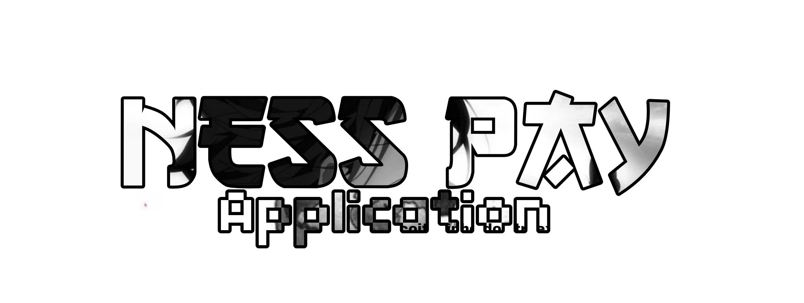

# NessPay — Dashboard

Painel **preto e branco** para o **NessPay**, bot de vendas pagas no Discord.
React + TypeScript + Vite + Tailwind + Recharts. Estética brutalista/monocromática com o logo em cromo.



## Rodando

```bash
npm install
npm run dev      # http://localhost:5173
npm run build    # build de produção em dist/
```

## Telas

| Rota | Tela | O que tem |
| --- | --- | --- |
| `/` | Visão geral | KPIs, gráfico de receita 30d, mix de pagamento/categoria, últimas vendas, feed de atividade, saúde do bot |
| `/vendas` | Vendas | Tabela com busca + filtros (status/método), export CSV, modal com timeline do pedido |
| `/produtos` | Produtos | Grid de cards, toggle ativo/pausado, estoque, entrega automática, criação de produto |
| `/clientes` | Clientes | Base com tier (novo/recorrente/VIP), modal com histórico de compras |
| `/cupons` | Cupons | CRUD visual, limite de usos, validade, regras de desconto |
| `/tickets` | Tickets | Lista + thread de atendimento com resposta |
| `/integracoes` | Integrações | Checklist de conexões e variáveis de ambiente faltando |
| `/configuracoes` | Configurações | Prefixo, canais, automações, webhooks |
| `/entrar` | Login | Tela de acesso com Discord OAuth (visual) |

> **Todos os dados são mock** (`src/data/mock.ts`). O painel é 100% front-end por enquanto.

## Estrutura

```
src/
├── components/     # Layout (sidebar/topbar), ui.tsx (cards, tabelas, modal), charts.tsx
├── data/mock.ts    # dados de demonstração
├── lib/format.ts   # formatação BRL, datas, labels
└── pages/          # uma página por rota
```

## O que falta conectar

Tudo que é "vivo" ainda depende de backend. A ordem recomendada:

1. **Discord — aplicação/bot**: `DISCORD_BOT_TOKEN`, `DISCORD_GUILD_ID`, intents `GUILDS`, `GUILD_MESSAGES`, `MESSAGE_CONTENT`.
2. **Discord — OAuth2** (login do painel): `DISCORD_CLIENT_ID`, `DISCORD_CLIENT_SECRET`, `DISCORD_REDIRECT_URI` + `DISCORD_STAFF_ROLE_ID` para checar o cargo de staff.
3. **Banco**: Supabase (`SUPABASE_URL`, `SUPABASE_SERVICE_ROLE_KEY`) com tabelas `products`, `orders`, `order_items`, `coupons`, `coupon_uses`, `customers`, `tickets`, `ticket_messages`, `stock_items`, `deliveries`.
4. **Gateway de pagamento**: Mercado Pago (`MP_ACCESS_TOKEN`, `MP_WEBHOOK_SECRET`) para Pix/cartão — ou Stripe. Sem webhook validado não existe entrega automática.
5. **Webhook público** (`PUBLIC_WEBHOOK_URL`): precisa ser HTTPS acessível pela internet — não pode ser `localhost`.
6. **API do painel**: os endpoints abaixo ainda não existem.
   - `GET /api/orders` · `POST /api/orders/:id/refund` · `POST /api/orders/:id/redeliver`
   - `GET/POST/PATCH /api/products` · `GET/POST /api/coupons`
   - `GET /api/customers` · `GET/POST /api/tickets`
   - `POST /api/webhooks/pagamento` · `POST /api/webhooks/discord`
7. **Canal de logs** (`DISCORD_LOG_WEBHOOK`) e **e-mail** (`RESEND_API_KEY`, opcional).

Detalhes de cada variável em [`.env.example`](.env.example) e na tela `/integracoes`.
